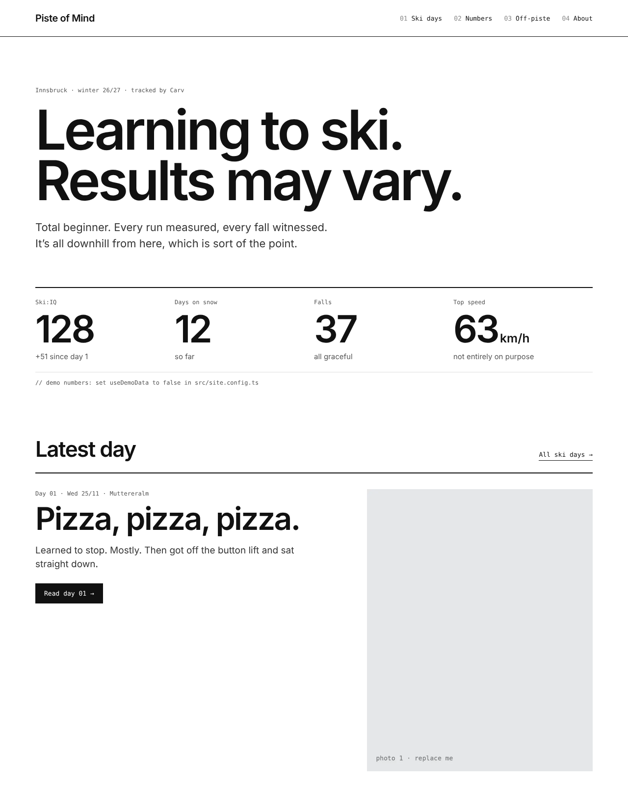

# Piste of Mind

A beginner's ski diary from Innsbruck. Every run tracked by [Carv](https://getcarv.com), every fall witnessed.

**Live:** https://zahra-cheeseman.github.io



## Pages

| Page | URL | What's on it |
|---|---|---|
| Home | `/` | Headline, four big numbers, latest ski day, latest off-piste posts |
| Ski days | `/days` | Every day on snow, newest first |
| One day | `/days/2026-11-25` | Title, location, temperature, weather, the day's Carv numbers, write-up, photos |
| Numbers | `/numbers` | **Overview** (totals + resort map), **Progress** (charts), **Day by day** (table) |
| Off-piste | `/off-piste` | Innsbruck, minus the skiing |
| About | `/about` | Who, why, Carv |
| Feed | `/rss.xml` | Every ski day as an RSS feed, for the email newsletter |

## Adding a ski day (about 10 minutes)

```bash
npm run new-day              # today
npm run new-day -- 2026-11-28  # or a specific date
```

That creates three things. Fill them in:

1. **`src/content/days/<date>.md`**: the diary entry.
   ```markdown
   ---
   title: "Less pizza, more chips"
   location: muttereralm    # a key from src/data/resorts.json
   temp: "−2°C"
   weather: "Grey, then less grey"
   summary: "Stopping now happens on purpose about 70% of the time."
   ---

   Write the day here. Normal paragraphs, nothing fancy.
   ```
2. **`src/data/sessions.json`**: a row for that date. Copy the numbers from the Carv app.
3. **`src/photos/<date>/`**: drop in as many photos as you like, straight off your phone. They're resized automatically. They show in file-name order, so call your favourite `01-something.jpg` to make it the first one (it's also used on the home page and in the email).

Then:

```bash
git add .
git commit -m "Day 2"
git push
```

The site rebuilds and updates itself in about a minute.

New resort? Add it to `src/data/resorts.json` with its coordinates and it appears on the map. If labels overlap, add `"label": "left"` (or `right` / `above` / `below`).

## Email updates

The site publishes an RSS feed at `/rss.xml` with every ski day (title, photo, numbers, summary, link). Most newsletter tools can watch an RSS feed and email new posts automatically. In Mailchimp, for example, that's an "RSS campaign". Point yours at `https://zahra-cheeseman.github.io/rss.xml`.

To show a signup form on the site, paste your newsletter tool's form URL into `newsletterAction` in `src/site.config.ts`.

## Running it on your computer

Needs [Node.js](https://nodejs.org) 22 or newer.

```bash
npm install
npm run dev     # → http://localhost:4321, reloads as you edit
```

## Putting it online (first time)

1. Create a GitHub repo called **`zahra-cheeseman.github.io`**. That name gives you the cleanest URL.
2. In `astro.config.mjs`, set `site: 'https://zahra-cheeseman.github.io'`. (Different repo name, e.g. `piste-of-mind`? Also set `base: '/piste-of-mind'`.)
3. Push:
   ```bash
   git init
   git add .
   git commit -m "Day 1"
   git branch -M main
   git remote add origin https://github.com/zahra-cheeseman/zahra-cheeseman.github.io.git
   git push -u origin main
   ```
4. On GitHub: **Settings → Pages → Source: GitHub Actions**.
5. Watch the **Actions** tab. When it's green, the site is live.

Before sharing it, set `useDemoData: false` in `src/site.config.ts` so the Numbers page uses your real data instead of the made-up demo season.

## How it's built

- **[Astro](https://astro.build)** turns Markdown files and JSON into plain static HTML. No database, no server.
- **Content collections** (`src/content.config.ts`) check that every diary entry has the fields it needs, so a typo fails the build instead of breaking the page.
- **Charts and the map are plain SVG**, drawn when the site builds. No chart libraries and almost no JavaScript (just the tabs and the photo viewer).
- **Images** are resized and converted to WebP at build time.
- **GitHub Actions** (`.github/workflows/deploy.yml`) builds and deploys on every push.

```
src/
  site.config.ts        ← name, headline, newsletter, demo toggle
  content/days/         ← one Markdown file per ski day
  content/off-piste/    ← one Markdown file per non-ski post
  data/sessions.json    ← Carv numbers, one row per day
  data/resorts.json     ← resorts + map coordinates
  photos/<date>/        ← photos for each ski day
  photos/off-piste/<post>/
  pages/                ← every file is a URL
  components/           ← Stats, Photos, ResortMap, DayList, Subscribe
scripts/new-day.mjs     ← creates the files for a new day
```

## Ideas for later

- [ ] Pull numbers straight from Carv instead of copying them in
- [ ] Before/after video clips
- [ ] A "Carv from zero" end-of-season write-up
